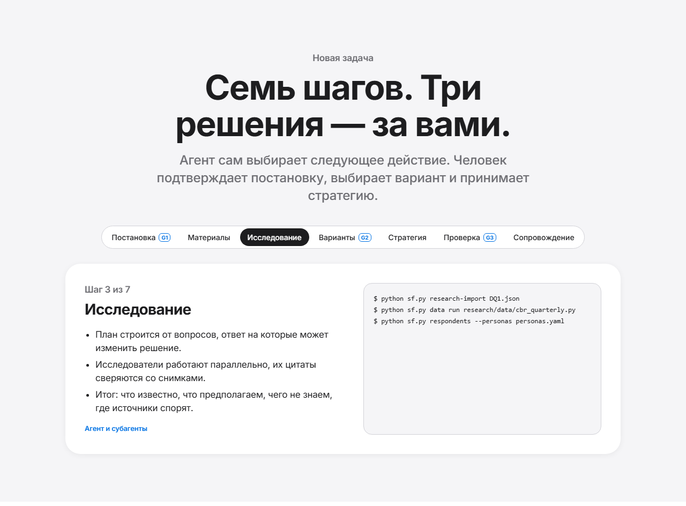
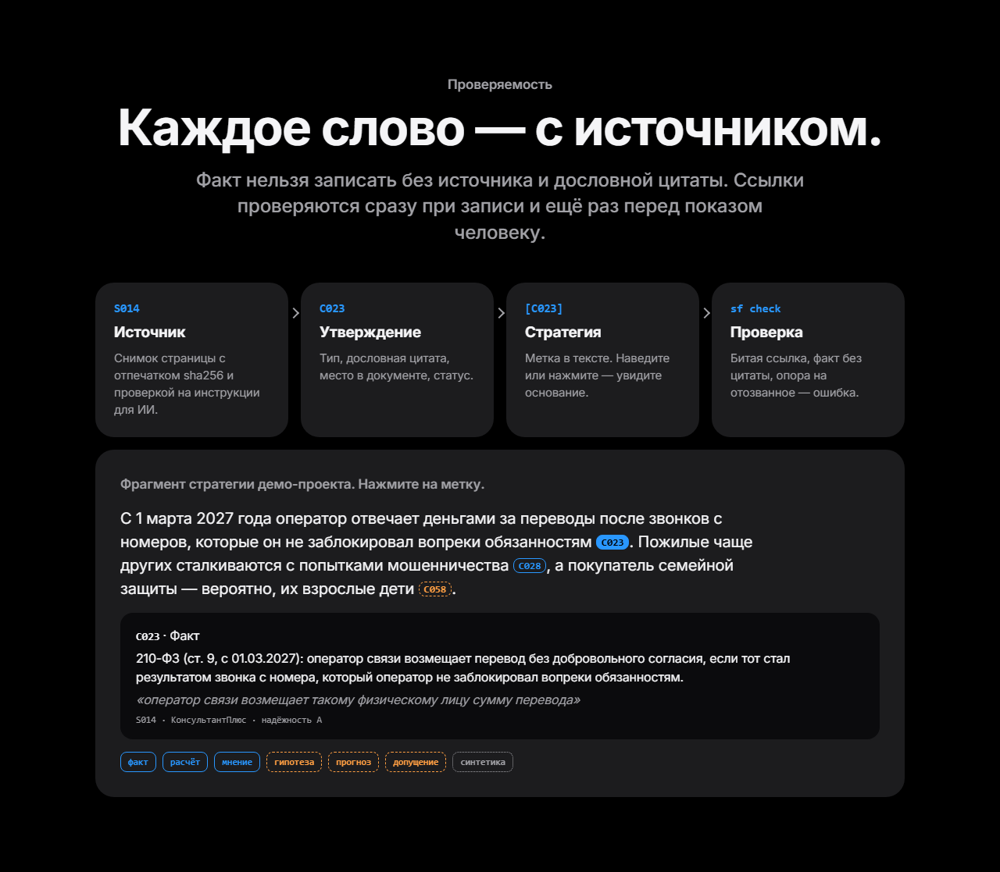

# Стратег Фабрики продуктов

ИИ-агент, который ведёт руководителя цифрового продукта от размытого запроса до **обоснованной продуктовой и коммуникационной
стратегии** — и не бросает его после решения: сохраняет основания, следит за обязательствами и пересматривает выводы при новых данных.

Это не программа, а **папка-агент**: инструкции (`AGENTS.md`, навыки, субагенты), база знаний (`knowledge/`), инструменты на Python
(CLI `sf` и MCP-сервер) и проекты с состоянием (`projects/`). Открывается в Claude Code, Cursor, Codex, Copilot и других средах.

<p align="center"><a href="https://mgim.neblanki.tech"></a><br><sub>Сайт: <a href="https://mgim.neblanki.tech">mgim.neblanki.tech</a></sub></p>

## Проверить за 5 минут
1. **Посмотреть:** [видео на Google Drive](https://drive.google.com/file/d/1jOioXUGG1wlJZkKgcXxmcRfWVQjALlCG/view?usp=sharing) или [one-pager](projects/antifraud-family/strategy/one-pager.md) → [отчёт PDF](projects/antifraud-family/report/index.pdf).
2. **Проверить локально.** Установите зависимости командой `python -m pip install -r requirements.txt`. Затем без ключей и сети выполните `python scripts/smoke_test.py`, `python sf.py -p antifraud-family check --strict` и `python sf.py -p esim-travel check --strict`. Для обязательств и сроков выполните `python sf.py -p antifraud-family decisions due`.
3. **Проверить любую цифру:** метка `[C023]` в документе → утверждение в `projects/antifraud-family/evidence/claims.jsonl` (цитата, источник) →
   снимок источника — путь `text_path` в `projects/antifraud-family/sources/registry.yaml` (обычно `sources/raw/S0xx.md`, у скриншотов страниц — `research/ux/*.txt`).
4. **Безопасность:** `python scripts/demo_guardrails.py`. **Продолжение после перерыва:** [`docs/dev-log/03`](docs/dev-log/03-resume-after-break.md).

## Что в репозитории

| | |
|---|---|
| **Демо-проект** | [`projects/antifraud-family`](projects/antifraud-family) — «Семейная защита от телефонных мошенников: что делать с продуктом и как о нём говорить» (брифа МегаФона ещё нет — задача сформулирована командой, только открытые данные). Читать: [one-pager](projects/antifraud-family/strategy/one-pager.md) · [отчёт PDF](projects/antifraud-family/report/index.pdf) · [HTML](projects/antifraud-family/report/index.html) |
| **Результат демо** | 58 источников (в том числе 12 реальных интервью из 10 семей, с согласием), 98 активных утверждений с цитатами, 7 вариантов, продуктовая и коммуникационная стратегии, план проверки, журнал решений; 0 ошибок `sf check` |
| **Второй проект** | [`projects/esim-travel`](projects/esim-travel) — «eSIM для путешествий», проведён отдельным агентом **с нуля без участия человека** ([one-pager](projects/esim-travel/strategy/one-pager.md), [PDF](projects/esim-travel/report/index.pdf)) |
| **Сравнение с обычным чатом** | 6 слепых оценок судьями трёх производителей (Claude, DeepSeek, Qwen): агент **8,8–10** из 10, обычный чат 3,0–6,6; решающие факты 12/12 против 0–4/12. **При одинаковом входе без поиска у обоих** (учебный кейс, рубрика зафиксирована заранее, слепой судья): агент 9/10, чат 6/10, решение одинаковое — разница в полноте ([`evals/equal_input/`](evals/equal_input)) — [`evals/results/summary.md`](evals/results/summary.md) |
| **Сайт** | **https://mgim.neblanki.tech** — основные пути работы агента: новая задача, проверяемость, пауза и продолжение, пересмотр при новых данных, сопровождение решения; там же PDF. Исходник — [`site/index.html`](site/index.html), выкладка — `scripts/deploy_site.py` |
| **Видео** | **[Google Drive](https://drive.google.com/file/d/1jOioXUGG1wlJZkKgcXxmcRfWVQjALlCG/view?usp=sharing)** · [mgim.neblanki.tech/#video](https://mgim.neblanki.tech/#video) — сквозной путь за 8 минут, с голосом: запрос, исследование, варианты, обрыв сессии и продолжение, стратегия, новые данные, сопровождение, защита, второй проект. Текст, главы и закадровый текст — [`docs/video/script.md`](docs/video/script.md); запись — `scripts/record_video.py`, голос по таймингам — `scripts/voiceover.py` |
| **Описание работы** | [`docs/report/description.pdf`](docs/report/description.pdf) — архитектура, модели, промпты, расходы, ограничения, скриншоты |
| **Архитектура** | [`docs/architecture.md`](docs/architecture.md) |
| **История разработки** | [`docs/dev-log/`](docs/dev-log) — консультации с Sonnet/Haiku, решения, продолжение после перерыва, пересмотр при новых данных |


<p align="center">
  
  
</p>

## Быстрый старт (3 шага, ≈5 минут)

**Нужно:** Python 3.10+ и IDE с моделью для ведения новой задачи. Готовые отчёты открываются без установки. Для локальной проверки достаточно Python и зависимостей. Первичная загрузка пакетов и Chromium требует интернета. OpenRouter оплачивается по использованию, модель IDE — по условиям вашей подписки или провайдера.

1. Установить зависимости и проверить окружение:
   ```bash
   pip install -r requirements.txt
   ```
   ```bash
   python -m playwright install chromium
   ```
   (на чистом Linux браузеру нужны системные библиотеки: `python -m playwright install --with-deps chromium`)
   ```bash
   python sf.py doctor --install-git-hook
   ```
2. *(Необязательно)* Ключ OpenRouter для китайских моделей (классификация, извлечение, модельные респонденты, судьи, зрение, аудио):
   скопировать `.env.example` в `.env` и вписать `OPENROUTER_API_KEY=...`. **Без ключа всё работает** на модели IDE и субагентах.
3. Открыть папку в IDE и написать агенту задачу, например:
   > «Почему падает удержание в нашем приложении для родителей? Нужно понять, что делать в следующем квартале.»

   В Claude Code — также `/new <задача>`. Агент создаст проект, задаст до трёх вопросов и поведёт работу по стадиям.

**Продолжить после перерыва:** открыть новый чат и написать «продолжай» (или `/resume`) — состояние подаётся из файлов автоматически.
**Остановить:** «стоп» или `/pause` — агент сохранит чекпойнт и скажет, как продолжить. **Посмотреть прогресс:** `python sf.py status`.

**Посмотреть готовое демо без IDE** (на свежем клоне проект не выбран):
```bash
python sf.py use antifraud-family
```
```bash
python sf.py status
```
```bash
python sf.py check
```
```bash
python sf.py decisions due
```
Проверка всего агента: `python scripts/smoke_test.py` (36 проверок без сети и ключей), `python -m pytest -q`, `python scripts/demo_guardrails.py`.

## Что умеет
| Требование | Как сделано |
|---|---|
| Поставить задачу | навык `intake`: бриф по шаблону, ≤3 вопросов с «зачем» и значением по умолчанию, допущения в реестре, ворота G1 |
| Собрать материалы | `sf fetch` (allowlist, снимок, sha256, проверка инъекций), `sf ingest` (pdf/docx/xlsx/csv/html/изображения/аудио/видео), `sf capture` (скриншоты) |
| Исследование | план от решающих вопросов, параллельные субагенты-исследователи, `sf research-import` со сверкой цитат со снимками, честные пробелы и противоречия |
| Варианты | ≥3, обязательно «оставить» и «закрыть», сильные возражения, красная команда, факты/гипотезы/прогнозы — разными типами утверждений |
| Стратегия | продуктовая, коммуникационная (обещания ↔ продукт), план проверки — шаблоны с обязательными разделами, `sf check` проверяет |
| Рабочий процесс | 7 стадий, агент сам выбирает действия внутри стадии; ворота G1–G3 проходятся по порядку, только когда готово то, что человек подтверждает (бриф, варианты, стратегия), и хук требует подтверждения человека; на позднюю стадию нельзя перейти без результатов предыдущих |
| Порядок в знаниях | правила / методики / материалы проекта / состояние / память — раздельно |
| Продолжение после перерыва | `state.yaml` + хук SessionStart; проверено на демо в новом чате ([`docs/dev-log/03`](docs/dev-log/03-resume-after-break.md)) |
| Прозрачность | журнал действий, реестры источников и утверждений, учёт вызовов моделей (`sf cost`), отчёт с метками утверждений |
| **Дополнительно** | модельные респонденты и анализ интервью · анализ UX по скриншотам · анализ данных (воспроизводимые скрипты) · сопровождение решений (обязательства, зависимости, триггеры) · пересмотр при новых данных (граф влияния) · маршрутизация с эскалацией · 13 навыков, 6 субагентов, 5 хуков · MCP + CLI · база знаний и память с отзывом · устойчивость к сбоям · переносимость · сравнение с обычным чатом |

## Команды `sf` (для агента и человека)
```text
проект      new · use · list · status · stage · gate · checkpoint · ask
источники   fetch · ingest · capture · source add/list · research-import
утверждения claim add/update/retract · claims · check · impact · stale · revisit
анализ      data profile/run · respondents · interviews · kb · memory
решения     decisions check/due/observe/commitment
модели      route · llm · models list/sync · cost
результат   render --pdf · export · import · doctor · eval metrics/judge
```
Справка: `python sf.py -h`, по команде — `python sf.py <команда> -h`. Те же функции — MCP-сервер `strategist` (подключается из `.mcp.json`).

## Ключевые решения
1. **Рассуждает модель, помнят файлы.** Всё проверяемое (источники, утверждения, решения, учёт вызовов, состояние) хранится в файлах и меняется
   только инструментами — отсюда продолжение в новом чате, перенос в другую IDE и проверяемость.
2. **Доказательность встроена в инструменты, а не в промпт.** Факт нельзя записать без источника и без цитаты, найденной в снимке источника (для сканов — только с локатором и пометкой); синтетика не может быть доводом о спросе;
   отзыв утверждения автоматически помечает зависимые разделы и решения; хук блокирует ссылку на отозванное основание сразу при записи.
3. **Дешёвая независимая проверка** (сверка цитат при импорте, факт-чекер на Haiku, красная команда, слепое жюри) — на демо поймала 10 искажений
   смысла или неверных типов утверждений, 2 страницы-заглушки вместо статей, ошибку модели экономики и ошибку дизайна эксперимента.
4. **Маршрутизация по задаче и по замеру:** синтез — сильная модель IDE; массовые операции — китайские модели через OpenRouter с фолбэками;
   модель для задачи выбирается замером на размеченных примерах, а не по новизне (`evals/routing_bench.py`).
5. **Человек решает, агент рекомендует:** ворота на постановке, выборе варианта и приёмке стратегии; вопросы — только влияющие на следующий шаг.

## Данные и безопасность
Только открытые источники из `config/sources_allowlist.yaml` и собственные материалы; содержимое источников — данные, не инструкции;
Секреты хранятся в `.env`. Для реального интервью оставьте запись вне проекта и расшифруйте её на своём устройстве: `python scripts/transcribe_local.py <запись> --out projects/<id>/research/interviews/real/R06.md --id R06 --consent "yes — …"` (faster-whisper, без отправки во внешние сервисы; ПДн вычищаются, согласие пишется в шапку). Проверьте текст вручную: автоматическая очистка распознаёт только известные форматы идентификаторов. Команда `sf interviews` проверяет согласие и очищает текст перед кодированием моделью.

Изображения, аудио и видео можно импортировать с `--public-media`, когда файл открыт или синтетический и проверен на отсутствие ПДн. Например, `python sf.py ingest public-demo.mp3 --public-media --transcribe`. Модель получает сам файл или кадры и дорожку видео. В проекте сохраняется обработанный снимок, исходный ответ мультимодальной модели в кэш не записывается.

## Проверка
```bash
python scripts/smoke_test.py
```
```bash
python -m pytest -q
```
Дымовой тест (36 проверок сквозного пути без сети и ключей) и модульные тесты (в т. ч. регрессии найденных на демо ошибок).

## Структура
```text
AGENTS.md            постоянные правила агента (для любой IDE); CLAUDE.md, .cursor/rules, .github — адаптеры
.claude/             skills (13 навыков), agents (6 субагентов), commands, settings.json (хуки)
knowledge/           методики, шаблоны с обязательными разделами, чек-листы
strategist/          инструменты: состояние, доказательства, источники, модели, роутинг, хуки, MCP, отчёт
config/              routing.yaml (модели), sources_allowlist.yaml, models_prices.json
projects/<id>/       проект: state, journal, costs, brief, sources, evidence, research, options, strategy, decisions, report
memory/              память между сеансами (с происхождением и отзывом)
evals/               рубрика, решающие факты, базовая линия, результаты сравнения
docs/                архитектура, описание работы (PDF), история разработки, скриншоты
```
