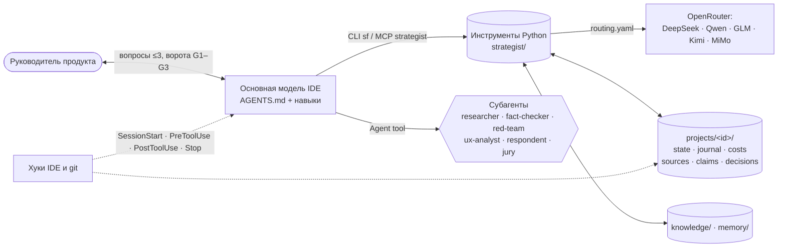

# Архитектура агента «Стратег»

## 1. Идея
Агент — это **LLM внутри IDE** (Claude Code, Cursor, Codex, Copilot), которая читает постоянные правила (`AGENTS.md`), сама ведёт
работу по стадиям и для всего, что должно быть **проверяемым**, вызывает детерминированные инструменты на Python (CLI `sf` и
MCP-сервер `strategist`). Рассуждение — у модели; состояние, источники, утверждения, решения и стоимость — в файлах.
Поэтому работу можно остановить и продолжить в новом чате или другой IDE, а каждый вывод — проверить.

## 2. Рабочий процесс
| Стадия | Что делает агент | Инструменты | Выход / ворота |
|---|---|---|---|
| 0 Постановка | читает запрос и материалы, заполняет бриф, задаёт ≤3 вопроса с «зачем» и значением по умолчанию | `sf new`, `sf ask`, `sf claim add --kind assumption` | **G1** — человек подтверждает |
| 1 Материалы | собирает документы, таблицы, сайты, скриншоты, аудио/видео | `sf fetch` (allowlist, снимок, sha256, инъекции), `sf ingest`, `sf capture` | реестр источников |
| 2 Исследование | план от решающих вопросов, параллельные исследователи, сверка цитат, данные, интервью, UX | `researcher`×N, `sf research-import`, `sf data`, `sf respondents`/`respondent`, `ux-analyst`, `fact-checker` | `findings.md`: известно / предполагаем / **не знаем** / противоречия |
| 3 Варианты | ≥3 варианта, включая «оставить» и «закрыть», возражения, экономика порогов | `sf data run` (модели), `red-team`, `sf check` | **G2** — человек выбирает |
| 4 Стратегия | продуктовая, коммуникационная, план проверки, журнал решений | навыки `product-strategy`, `comms-strategy`, `validation-plan` | согласованы между собой |
| 5 Проверка | one-pager, ворота качества, отчёт | `fact-checker`, `red-team`, `jury`, `sf check`, `sf render --pdf` | **G3** — человек принимает |
| 6 Сопровождение | обязательства, триггеры, пересмотр при новых данных | `sf decisions due/observe`, `sf revisit`, `sf impact --mark-stale` | обновления с «было → стало» |

Агент сам выбирает следующее действие внутри стадии (какие источники, сколько исследователей, когда достаточно данных).
Человек подключается на воротах, при новом домене-источнике и при правке выводов. Режим `autopilot` проходит ворота как допущения.

## 3. Знания и контекст: четыре слоя + память
| Слой | Где | Кто меняет | Защита |
|---|---|---|---|
| Постоянные правила | `AGENTS.md`, `CLAUDE.md`, `.claude/agents`, `.claude/skills`, `.cursor/rules`, `config/` | только человек | хук `pre_tool` спрашивает подтверждение на запись (вне `.dev-mode`) |
| Методические знания | `knowledge/methods` (17), `templates` (11), `checklists` (3) | человек / агент по просьбе | — |
| Материалы проекта | `projects/<id>/sources`, `research`, `evidence` | агент через инструменты | снимки с sha256, флаги инъекций |
| Состояние задачи | `state.yaml`, `journal.jsonl`, `costs.jsonl`, `decisions.yaml` | `sf` и хуки | атомарная запись |
| Память между сеансами | `memory/entries.jsonl` | `sf memory add/retract/review` | у записи — происхождение и срок; **вывод агента = гипотеза, не факт** |

**Доказательная база.** Источник `S0xx` (URL/файл, издатель, дата, надёжность A–D, sha256 снимка, флаги инъекций) → утверждение `C0xx`
(тип: факт / расчёт / мнение / гипотеза / прогноз / допущение / синтетика; дословная цитата; статус active / disputed / retracted / superseded;
зависимости) → ссылки `[C0xx]` в документах. `sf check` проверяет связи, обязательные разделы шаблонов, ≥3 варианта с возражениями,
опору на отозванные утверждения, синтетику как довод о спросе, числа без ссылок и покрытие фактических строк.

**Поиск по базе знаний** (`sf kb`, MCP `kb_search`): по формулировке — BM25 с русским стеммингом; по смыслу — `--rerank` дешёвой моделью;
по связям — `links:` во frontmatter и `[[wiki-ссылки]]` (в выдаче показываются связанные методики).

**Экономия контекста:** агент читает не весь источник, а нужные строки снимка; длинное сжимает `sf llm summarize`; работа над проектом
ведётся короткими чатами по стадиям — состояние подаётся хуком, а не историей переписки.

## 4. Маршрутизация (процесс, модель, инструмент)
1. **Процесс:** `sf route` — правила по ключевым словам (бесплатно) → дешёвый классификатор `qwen3.7-flash` → вопрос человеку.
   Исправление человека (`sf route --correct`) сохраняется в `memory/routing_corrections.jsonl` и применяется точно и как пример.
2. **Модель:** `config/routing.yaml` — у каждой задачи цепочка моделей. При сбое (429/5xx/таймаут) — повтор с паузой; при невалидном
   JSON или провале проверки качества — **эскалация на следующую модель** с записью в журнал (`model_escalation`).
3. **Инструмент:** CLI для любой IDE и для человека; MCP — типизированные вызовы (без проблем экранирования кириллицы в оболочке).

| Задача | Модель (OpenRouter) | Фолбэк | Почему |
|---|---|---|---|
| классификация | z-ai/glm-5.3-flash | deepseek-v4-flash, qwen3.7-flash | **по замеру** (`evals/routing_bench.py`): 93,8% за $0,17/1000 вызовов; Kimi K3.1 Pro — та же точность в 5 раз дороже |
| реранк | qwen/qwen3.7-flash | deepseek-v4-flash | короткий JSON, $0,03/$0,13 за 1 млн, рассуждения отключены |
| извлечение утверждений, кодирование интервью | deepseek/deepseek-v4.1-flash | qwen3.8-flash | длинный контекст 1 млн, дёшево |
| сжатие | qwen/qwen3.7-flash | deepseek-v4-flash | экономия контекста основной модели |
| модельные респонденты, интервьюер | deepseek-v4-flash / qwen3.7-flash | qwen3.8-flash | ролевая генерация; ротация — опция |
| судья, критик | deepseek/deepseek-v4-pro | kimi-k2.6, qwen3.7-plus | **другое семейство**, чем основная модель; Kimi сильный, но отвечает 3–6 мин — запасной |
| зрение | qwen/qwen3.8-flash | glm-5.3-flash | скриншоты интерфейсов |
| аудио | qwen/qwen3.8-omni-flash | xiaomi/mimo-v2.6-flash | расшифровка открытых и синтетических записей (`--public-media`); реальные интервью — локально, `scripts/transcribe_local.py` |
| синтез стратегии | основная модель IDE | — | цена ошибки максимальна |

Без ключа OpenRouter все шаги выполняются основной моделью и субагентами (так прошёл демо-проект); `STRATEGIST_REPLAY=1` воспроизводит
сохранённые ответы моделей без ключа и без затрат.

## 5. Субагенты, навыки, хуки, команды
- **Субагенты** (`.claude/agents`, вызываются по имени): `researcher` (Sonnet; поиск по одному решающему вопросу, без права записи),
  `fact-checker` (Haiku; только чтение, сверка со снимками), `red-team` (Sonnet; только чтение), `ux-analyst` (Sonnet; скриншоты),
  `respondent` (Haiku; синтетика без ключа), `jury` (оценка по рубрике). В Cursor/Codex те же тексты — отдельным чатом.
- **Навыки** (`.claude/skills`, 13): по одному на стадию и вид работы; в других IDE это обычные markdown-инструкции.
- **Хуки:** `SessionStart` — подаёт статус проекта (продолжение в новом чате); `UserPromptSubmit` — «стоп/пауза» → чекпойнт;
  `PreToolUse` — allowlist для WebFetch и загрузок, запрет чтения `.env`, запрет записи секретов, защита файлов правил;
  `PostToolUse` — журнал записи и **проверка ссылок в документе сразу после записи** (блокирует ссылку на отозванное утверждение);
  `Stop` — учёт токенов основной модели по транскрипту и напоминание о чекпойнте. Cursor: `.cursor/hooks.json`. Git: pre-commit на секреты.
- **Команды:** `/new`, `/resume`, `/status`, `/pause`, `/decide`, `/revisit`, `/report`, `/check` (Claude Code и Cursor).

## 6. Устойчивость к сбоям
- **Идемпотентность:** загрузка того же URL, импорт того же файла, повтор интервью с той же персоной не выполняются повторно
  (ключи в журнале); ответы моделей кэшируются — повторный запуск не платит.
- **Сбои инструментов замечаются:** статус `failed` в журнале, счётчик сбоев в `sf status`; заглушки антибота не сохраняются как
  источники (детектор + регрессионные тесты — на демо он дважды ловил такие страницы).
- **Атомарная запись** YAML/JSONL (обрыв не портит состояние); хуки не роняют сессию (ошибки — в `.cache/hook_errors.log`).

## 7. Переносимость
| Возможность | Claude Code | Cursor | Codex / Copilot / другие |
|---|---|---|---|
| Правила | `CLAUDE.md` → `AGENTS.md` | `.cursor/rules/strategist.mdc` | `AGENTS.md`, `.github/copilot-instructions.md` |
| Инструменты | CLI + MCP (`.mcp.json`) | CLI + MCP (`.cursor/mcp.json`) | CLI |
| Субагенты | `.claude/agents` | фоновые агенты / отдельный чат с тем же текстом | отдельный чат |
| Хуки | все 5 | shell / правка файла / stop | git pre-commit + `sf check` вручную |
| Продолжение | хук SessionStart | правило «сначала `sf status`» | то же |
| Перенос проекта | `sf export` → zip → `sf import` в другой копии репозитория |||

## 8. Безопасность
Источники — данные, не инструкции (карантинная обёртка при передаче моделям, детектор инъекций, исследователь без права записи);
только домены из `config/sources_allowlist.yaml`; только открытые данные; секреты только в `.env` (gitignore, хук, pre-commit, `sf doctor`);
Для реальных интервью принимается предварительно обезличенный текст с `consent: yes` в шапке. Перед кодированием распознаваемые идентификаторы удаляются ещё раз. Открытые медиа без ПДн принимаются с `--public-media`; внешнее распознавание получает исходные кадры или звук, ответ сохраняется в обработанном снимке. Правила меняет только человек.
